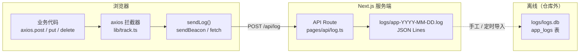

## 1. 背景

埋点可以记录用户行为，让我们分析系统操作哪些是高频低频，而且可以追溯到是哪一个用户修改了系统数据，这对于分析遇到的问题和改进系统有很大帮助。

## 2. 技术实现

### 2.1 总体链路

现有实现是一条 **「浏览器采集 → 非阻塞上报 → 服务端落盘 → 离线落库」** 的四段式链路，全部代码集中在 3 个文件内。



关键特征：

- **无侵入**：业务代码不需要任何埋点调用，拦截器注册在全局 axios 默认实例上（`src/lib/utils.ts` 中设置了 `axios.defaults.withCredentials = true`），所有走 axios 的请求自动纳入。
- **同源上报**：上报地址 `/api/log` 与页面同源，避免跨域与 CORS 预检，也使得 `sendBeacon` 可以正常工作。
- **异步解耦**：上报与业务响应完全解耦，落盘失败不影响业务。

### 2.2 采集层：`src/lib/track.ts`

核心由五部分组成。

**（1）拦截范围白名单**

```ts
const TARGET_METHODS: TargetMethod[] = ['post', 'put', 'patch', 'delete'];
```

只采集**写操作**，`GET` 请求不采集。设计取舍：写操作代表状态变更，是真正需要留痕的行为；读操作量级大且语义弱，采集价值与成本不成正比。

**（2）请求拦截器：打时间戳**

```ts
axios.interceptors.request.use((config) => {
  const method = config.method?.toLowerCase();
  if (method && TARGET_METHODS.includes(method)) {
    (config as ExtendedAxiosRequestConfig).metadata = { startTime: Date.now() };
  }
  return config as ExtendedAxiosRequestConfig;
});
```

在 `config.metadata` 上挂载 `startTime`，供响应阶段计算耗时。只在白名单方法上挂载，避免无谓开销。

**（3）响应拦截器：成功与失败双路径**

成功路径与失败路径分别构造日志对象。两者字段基本一致，失败路径额外带 `error` 字段，且 `status` 在网络层失败时兜底为 `0`：

```ts
status: error.response?.status || 0,
error: error.message || 'Network Error',
```

**（4）目标对象标识 → 可读名称翻译**

```ts
function getFormName(url: string): string {
  const match = url.match(/\/forms\/([a-f0-9-]+)\/records/);
  if (match) return formNameMap[match[1]] || match[1];
  return url;
}
```

从 URL 中提取目标对象标识，在 `formNameMap`（42 条映射，覆盖两套环境）中查表。**查不到时降级为裸 ID，URL 不匹配时降级为 URL 原文**。

**（5）操作类型与用户名**

```ts
const actionMap = { post: '新增', put: '修改', patch: '修改', delete: '删除' };
```

用户名从 `localStorage` 读取 ，读取失败或未登录时兜底为 `unknown`。

**日志字段定义**

| 字段        | 类型   | 必填 | 说明                                                       |
| ----------- | ------ | ---- | ---------------------------------------------------------- |
| `method`    | string | 是   | 大写 HTTP 方法，如 `POST`                                  |
| `url`       | string | 是   | axios 的 `config.url`，相对路径，含记录 ID                 |
| `form`      | string | 是   | 目标对象可读名称；查表失败为裸 ID；URL 不匹配时为 URL 原文 |
| `action`    | string | 是   | `新增` / `修改` / `删除`                                   |
| `status`    | number | 是   | HTTP 状态码；网络失败为 `0`                                |
| `duration`  | number | 是   | 浏览器端往返耗时（ms），含网络与服务端处理时间             |
| `username`  | string | 是   | 用户昵称；未知为 `unknown`                                 |
| `error`     | string | 否   | 仅失败路径存在，如 `Request failed with status code 403`   |
| `timestamp` | string | 是   | ISO 8601 **UTC** 时间，如 `2026-09-16T01:03:45.569Z`       |

**注册时机**：在 `src/pages/_app.tsx` 的 `useEffect` 中调用一次。

```ts
useEffect(() => {
  setupLogger();
}, []);
```

### 2.3 传输层：非阻塞上报

```ts
function sendLog(logData: LogEntry): void {
  if (typeof navigator !== 'undefined' && navigator.sendBeacon) {
    const blob = new Blob([JSON.stringify(logData)], { type: 'application/json' });
    if (navigator.sendBeacon(LOG_ENDPOINT, blob)) return;
  }
  fetch(LOG_ENDPOINT, {
    method: 'POST',
    headers: { 'Content-Type': 'application/json' },
    body: JSON.stringify(logData),
  }).catch(() => {});
}
```

设计要点：

- **`sendBeacon` 优先**：浏览器在空闲时机发送，页面卸载时也能送达，不会因为用户关页面而丢日志。
- **`fetch` 降级**：`sendBeacon` 不可用或返回 `false`（队列满）时降级。
- **静默失败**：`.catch(() => {})` 吞掉所有异常，埋点绝不抛错到业务链路。
- **避免递归**：上报走的是 `sendBeacon` / 原生 `fetch`，**不经过 axios 拦截器**，因此不会产生「上报请求被再次上报」的无限递归。

### 2.4 落盘层：`src/pages/api/log.ts`

```ts
const LOG_DIR = path.join(process.cwd(), 'logs');
if (!fs.existsSync(LOG_DIR)) fs.mkdirSync(LOG_DIR, { recursive: true });

function getLogFilePath() {
  const date = new Date().toISOString().slice(0, 10);
  return path.join(LOG_DIR, `app-${date}.log`);
}
```

- **存储格式**：JSON Lines（每行一个独立 JSON），便于 `grep`、`jq`、流式逐行解析。
- **文件切分**：按 **UTC 日期**切分为 `app-YYYY-MM-DD.log`。
- **写入方式**：`fs.promises.appendFile`，追加写，不覆盖。
- **最小校验**：只校验 `method` 与 `url` 是否存在，缺失返回 400；非 POST 返回 405。
- **目录初始化**：模块加载时创建 `logs/` 目录（已通过 `.gitignore` 的 `logs/*` 排除，不会进仓库）。

### 2.5 离线落库：`logs/logs.db`

日志文件之外，`logs/` 下还存在一个 SQLite 数据库，用于把 JSON Lines 转成可查询的结构化表。

**`app_logs` 表**

```sql
CREATE TABLE app_logs (
  id         INTEGER PRIMARY KEY AUTOINCREMENT,
  timestamp  TEXT    NOT NULL,
  method     TEXT    NOT NULL,
  url        TEXT    NOT NULL,
  form       TEXT,
  action     TEXT,
  status     INTEGER,
  duration   INTEGER,
  username   TEXT,
  error      TEXT,
  raw        TEXT    NOT NULL,   -- 保留原始 JSON 行
  created_at TEXT    NOT NULL DEFAULT (datetime('now'))
);
```

**`imported_log_files` 表**：记录已导入的文件名、行数与导入时间，实现**幂等导入**（重复执行不会产生重复数据）。

```sql
CREATE TABLE imported_log_files (
  name        TEXT PRIMARY KEY,
  lines       INTEGER NOT NULL,
  imported_at TEXT    NOT NULL DEFAULT (datetime('now'))
);
```

---
